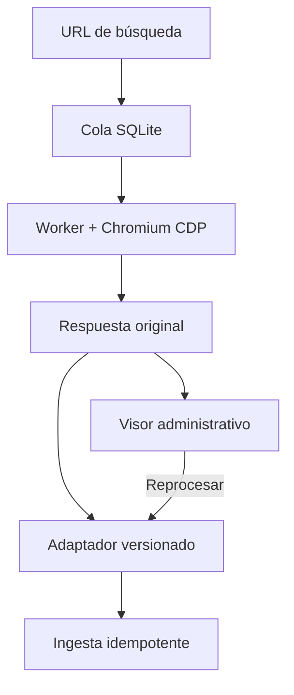

# Workers de navegador independientes

El worker Node se conecta por CDP a un Chromium dedicado, abre una pestaña propia y escucha sus respuestas antes de navegar. Captura el cuerpo de las respuestas seleccionadas sin consultar el DOM para extraer anuncios. El formato de captura **no presupone JSON**: conserva bytes en Base64, tipo MIME, estado HTTP, ruta de origen, fecha y SHA-256. Chrome entrega el cuerpo descomprimido, no los bytes de transporte TLS/gzip. No se almacenan cookies, cabeceras de autorización, cuerpos de petición ni parámetros de query. El cuerpo original puede contener datos de la fuente y tiene acceso administrativo.

La captura es pasiva: no retrasa la respuesta del portal para garantizar que termine de guardarse antes de que renderice. Es independiente del renderizado. No reenvía peticiones privadas de la API ni evita controles de acceso. Un 401, 403 o 429 detiene el trabajo.



## Arranque local

Requisitos: Node 22.13 o superior; un Chromium instalado por Playwright o una ruta `CHROMIUM_EXECUTABLE`. No se utiliza el perfil personal de Chrome. Desde `workers/browser`:

```bash
npm ci --ignore-scripts
npx playwright-core install chromium
cp sources.example.json sources.local.json
npm run browser
```

En otra terminal, carga `SCRAPER_API_KEY` desde el gestor de secretos y ejecuta `npm start`. La clave debe tener al menos 24 caracteres. El servicio escucha en `127.0.0.1:8000` y se conecta a `http://127.0.0.1:9222` por defecto. Ambos servicios se ejecutan en tu máquina, fuera del editor anterior.

| Configuración | Uso |
| --- | --- |
| `CDP_ENDPOINTS` | Hasta cuatro endpoints separados por comas, uno por navegador. HTTP/WS solo en loopback; usar TLS para un endpoint remoto protegido. |
| `SOURCES_FILE` | Archivo de fuentes, por defecto `sources.local.json`. Se lee al arrancar. |
| `WORKER_DB` | SQLite persistente; por defecto `data/worker.sqlite`. |
| `SCRAPER_API_KEY` | Autentica el API del worker; no se entrega al cliente web. |
| `SUPABASE_URL`, `SCRAPER_SECRET` | Destino fijo de ingesta y secreto de ingesta distinto de la clave del worker. Opcionales en modo captura. |
| `PORT`, `HOST` | Puerto 8000 y loopback por defecto; detrás de un proxy privado puede escuchar en otra interfaz. |
| `CDP_PORT`, `BROWSER_PROFILE`, `HEADLESS` | Configuración del lanzador de Chromium. Perfil dedicado por puerto; `HEADLESS=false` permite verlo en una máquina con escritorio. |

Para varios navegadores locales, arrancar una instancia con `CDP_PORT=9223` y un perfil distinto y añadirla a `CDP_ENDPOINTS`. Cada navegador atiende un trabajo a la vez. La cola y las reservas de navegador viven en SQLite y sobreviven a reinicios. Varios procesos en **un mismo host y base SQLite** se coordinan mediante transacciones y leases; no se anuncia una cola distribuida entre máquinas. Un trabajo interrumpido no se repite automáticamente contra el portal.

## Despliegue con contenedores

Desde la raíz, preparar `workers/browser/sources.local.json`, las variables públicas del frontend y los secretos del worker. Ejecutar `docker compose up --build -d`. El frontend se publica en loopback 8080 y el API en loopback 8000. Chromium y worker comparten el espacio de red; el puerto CDP no se publica en el host. Los volúmenes conservan perfiles y cola. El frontend y el API requieren un proxy HTTPS propio para exponerlos a usuarios y a las Edge Functions.

Configurar `BROWSER_WORKER_URL` y `SCRAPER_API_KEY` en las Edge Functions. La nueva función `browser-worker` verifica el rol de administrador antes de consultar el servicio. El panel `/scraper` inicia búsquedas, muestra estados, abre respuestas originales y solicita reprocesamiento. La cuenta Supabase debe pertenecer al operador; cambiar variables no migra datos ni cuentas del entorno anterior.

El `Dockerfile` raíz sirve la aplicación compilada con Nginx y fallback de rutas SPA. El `Dockerfile` del worker tiene un objetivo `worker` y otro `browser`. La versión de `playwright-core` y su navegador instalado deben coincidir. No usar `vite preview` como servidor de producción.

## Validación de cada fuente

Los ejemplos incluidos son **captura sin publicación**. El endpoint de Fotocasa procede del código anterior y aún debe contrastarse con una traza actual. La configuración de Pisos.com descubre respuestas XHR/fetch del mismo origen; después debe estrecharse a las rutas útiles observadas. Ningún ejemplo pretende acreditar un contrato vigente del portal.

1. Abrir una búsqueda real en un navegador dedicado y obtener su URL y una traza HAR saneada con cuerpos de respuesta. Revisar `Content-Type`, bytes, paginación y peticiones que provocan cambios de filtros.
2. Configurar `responses` con orígenes y prefijos observados. El recurso predeterminado es `xhr`/`fetch`; una regla puede declarar `resource_types`, por ejemplo `document`, para conservar otra respuesta original. No hay extractor HTML.
3. Añadir, si hace falta, acciones de interfaz `click`/`fill` por rol y nombre accesible en `actions`. No se ejecuta código arbitrario del archivo de configuración. Las acciones se ejecutan después de cada navegación, con límites de tiempo.
4. Examinar el bruto en `/scraper`. Elegir un decodificador y mapear campos reales; comprobar precio, ciudad, tipo, operación, identidad, URL y características. Los campos desconocidos permanecen vacíos.
5. Reprocesar el bruto con el adaptador validado. No abre el navegador. Si la fuente cambia de esquema o faltan hechos esenciales, el trabajo queda en revisión, sin inventar anuncios.

Los decodificadores incluidos son JSON y NDJSON; texto arbitrario, HTML, protobuf, MessagePack u otros formatos se **conservan** pero necesitan un decodificador específico antes de normalizar. Una página que solo renderice desde SSR y no emita una respuesta seleccionada produce `no_matching_response`, no una búsqueda vacía correcta. Una lista explícitamente vacía en un contrato validado sí admite cero resultados.

Ejemplo **sintético** de adaptador, sin relación con el esquema real de un portal:

```json
{
  "version": "fixture-v1",
  "format": "json",
  "items_path": "data.ads",
  "id_path": "id",
  "url_path": "href",
  "fields": {"precio":"price", "ciudad":"city", "tipo_propiedad":"type", "metros":"surface", "descripcion":"description", "operacion":"operation"},
  "value_maps": {"tipo_propiedad":{"apartment":"piso"}, "operacion":{"sale":"venta"}}
}
```

Las rutas usan puntos y posiciones de array (`uris.0.value`); `$` selecciona la raíz, útil con NDJSON. Las equivalencias numéricas/booleanas se declaran por campo en `value_maps`. No se inventa una URL a partir de un identificador. Reiniciar el worker después de editar el archivo, revisar la vista normalizada y reprocesar.

## Importar una captura HAR

Para estudiar una traza sin depender del acceso de red de este entorno, detener temporalmente el worker y terminar la cola. Usar un HAR saneado con contenido de respuestas:

```bash
npm run import:har -- --file /ruta/captura.har --source pisos --url https://www.pisos.com/venta/pisos-murcia_capital/
```

La importación selecciona solo las respuestas configuradas y marca la procedencia como `har_import`. Omite cabeceras, cookies y parámetros; **no anonimiza el cuerpo**. Si al HAR le faltan cuerpos, falla explícitamente. Al reiniciar el worker, el trabajo aparece en el visor y se puede reprocesar. El archivo HAR no se versiona ni se publica.

Para una comprobación acotada con un Chromium propio: `npm run inspect -- --source pisos --url URL`. Usa su propio perfil, guarda en `data/inspect.sqlite`, nunca ingiere y termina tras una búsqueda. Un error aparece en el estado persistido; no significa que la prueba del portal haya pasado.

## Operación y límites

- API autenticado: `GET /sources`, `GET /jobs`, `POST /jobs`, `GET /jobs/:id`, `GET /jobs/:id/captures/:id`, `POST /jobs/:id/replay`. Solo `/health` es público. Los clientes usan el proxy administrativo, no una clave del worker en el frontend.
- El cuerpo de creación contiene `source_id`, `search_urls` (1–5 URLs explícitas) y `ubicacion` opcional como etiqueta. El worker no adivina ciudades ni páginas siguientes. No hay búsqueda masiva ni cron activo.
- Hasta 100 trabajos activos, 50 respuestas y 20 MB por trabajo; máximo 2 MB por respuesta. Los límites fallan de forma visible. Una respuesta sin tamaño declarado se comprueba después de que Chrome la lea; limitar también memoria del contenedor.
- El bruto y los estados terminales se eliminan a los siete días en la limpieza horaria. Cifrar el disco, limitar acceso y respaldar el volumen según la operación. Las sesiones del navegador están en un volumen distinto.
- Entrega al menos una vez: ante un fallo, se conserva el bruto y el operador reintenta. La ingesta PostgreSQL existente deduplica por origen e ID y detecta cambios. No se promete exactamente una entrega.
- No se publican resultados parciales de una navegación fallida. El replay está disponible tras una captura completa, no tras un error a mitad de recorrido.
- Tras la ingesta siguen los pasos supervisados de procesamiento y matching. Aún faltan validación real de fuentes, dimensionamiento y operación de producción.

## Referencias

- [Playwright: conexión CDP](https://playwright.dev/docs/api/class-browsertype#browser-type-connect-over-cdp).
- [Playwright: eventos de red](https://playwright.dev/docs/network#network-events).
- [Chrome: perfil dedicado para depuración remota](https://developer.chrome.com/blog/remote-debugging-port).
- [Vite: despliegue estático](https://vite.dev/guide/static-deploy.html).
