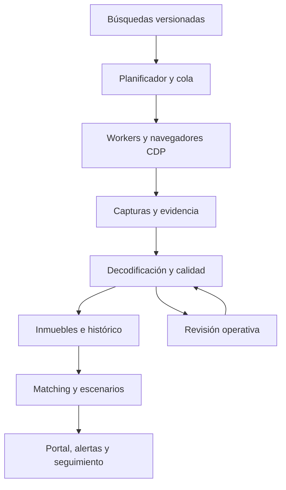

# InmoFinder — Plan maestro de producto, datos y comercialización

Fecha: 21 de septiembre de 2026. Código de referencia: `ce3496715cc97a2973e50a99790e4614e36cc37b`, rama `codex/commercial-foundation-20260920`, PR #1 abierta en borrador. Este documento propone trabajo futuro; no declara implementadas sus funciones ni autoriza nuevos gastos, mensajes a terceros o cambios de producción.

## 1. Objetivo y definición de éxito

Construir un producto que ayude a una persona a identificar, comparar y seguir viviendas que realmente encajan con su búsqueda, con evidencia suficiente para decidir qué revisar, descartar o visitar. Para el perfil inversor, añadir escenarios económicos editables y comparables trazables.

La propuesta de valor debe poder demostrarse: menos tiempo revisando anuncios irrelevantes, menos duplicados, menos sorpresas con datos incorrectos y más oportunidades revisadas a tiempo. La ventaja acumulativa puede estar en el histórico, la calidad, la resolución de identidades y el aprendizaje de preferencias, además de la captación de fuentes.

Resultado deseado del primer producto comercial:

- Búsqueda guardada y versionada; requisitos obligatorios y preferencias diferenciados.
- Resultados actuales, con origen, fecha, incertidumbre y explicación de compatibilidad.
- Un mismo inmueble agrupado entre anuncios, conservando discrepancias e historial.
- Alertas útiles y controlables; una bandeja de trabajo que lleve hasta la visita.
- Comparación de candidatos y análisis económico reproducible cuando haya evidencia.
- Operación medible: fallos visibles, recuperación, límites de consumo y soporte.
- Infraestructura y cuentas propias, con recuperación demostrada fuera del editor anterior.

La métrica principal propuesta es **oportunidades nuevas que el usuario califica como relevantes por búsqueda activa y semana**. Se acompaña de cobertura, calidad y tiempo ahorrado para impedir que mejore simplemente enviando menos anuncios. Una compra conseguida puede terminar la búsqueda: esa salida no debe confundirse con abandono por insatisfacción.

## 2. Estado real: qué hay y qué falta

| Área | Verificado en la rama | Pendiente para producto |
| --- | --- | --- |
| Independencia del editor | Retirados tagger y gateway de IA; frontend y workers propios configurables | Migrar cuenta/backend, datos, Auth, objetos y dominio del entorno anterior |
| Captura | Chromium real conectado por CDP contra servidor de pruebas; guarda texto/binarios y metadatos | Capturar tráfico actual de portales y confirmar cobertura y semántica de filtros |
| Fuentes | Ejemplos de Fotocasa/Pisos en modo captura | HAR actual, adaptadores y validación real; no hay integración de portal acreditada |
| Persistencia | SQLite, reservas de navegador, bruto, estados e importación HAR | Recuperación por fase, entrega reconciliable, operación continua y eventual coordinación entre hosts |
| Normalización | Reglas deterministas y revisión ante datos insuficientes | Contratos reales, trazabilidad por campo, cuarentena por registro y calidad longitudinal |
| Cliente | Alta, criterios, resultados, favoritos y edición básica | Experiencia completa, alertas, comparación, recuperación de acceso y gestión de cuenta |
| Matching | Requisitos obligatorios y desconocidos tratados explícitamente | Ranking de preferencias, geografía real, versiones y publicación consistente |
| Seguridad | Autorización, RLS y privilegios reforzados | Dependencias, revisión de configuración, secretos históricos y pruebas en Supabase real |
| Cobros | Preparación de Stripe con cobros desactivados | Cuenta/precios propios, aceptación integrada, cuotas y oferta validada |
| Verificación | 24 pruebas Node/PGlite, 10 del worker, 6 de interfaz; CI pasada | Pruebas contra servicios reales, dispositivos, carga, restauración y usuarios |
| Contenedores | Frontend construido/arrancado y worker construido en CI | Ensayo completo del conjunto Compose y contenedor de navegador |

La visita real de Pisos.com desde el Chromium separado terminó en `ERR_EMPTY_RESPONSE`. La visita desde el navegador integrado permitió revisar anuncios, pero no inspeccionar sus cuerpos HTTP. Ninguna de las dos acredita el adaptador de una API real.

La auditoría registrada en la revisión anterior (`npm audit --omit=dev`, 21-09-2026) devolvió 17 avisos: 2 críticos, 11 altos, 3 moderados y 1 bajo. Los críticos afectan a la cadena de jsPDF/autotable. Hay que volver a ejecutar la auditoría al abordar ese trabajo, estudiar alcance y actualizar con pruebas.

El documento anterior `COMMERCIAL_READINESS.md` conserva apartados históricos sobre Python/Flask y cifras de pruebas anteriores. Esta tabla es la referencia de planificación actual; reconciliar esa documentación en la fase 0.

## 3. Segmento inicial y ambición del producto

### Hipótesis recomendada

Validar primero con inversores particulares que buscan operaciones pequeñas en una zona que puedan evaluar bien. Una búsqueda de vivienda para alquiler a estudiantes puede ser un caso inicial, pero municipio, universidad, modalidad de alquiler y criterios deben ser datos configurables.

Este enfoque cambia la hipótesis de compradores particulares del plan anterior: **es una propuesta de producto**, pendiente de contrastarla con entrevistas y disponibilidad de datos de alquiler. Mantener el núcleo compartido de búsqueda, evidencia y comparación. Si no se consiguen datos fiables para inversión, lanzar la búsqueda asistida sin presentar una estimación económica como validada.

| Perfil | Trabajo que intenta resolver | Valor a demostrar | Momento |
| --- | --- | --- | --- |
| Comprador para vivir | Encontrar viviendas compatibles y organizar visitas | Tiempo ahorrado, relevancia y claridad | Núcleo común; posible piloto alternativo |
| Inversor particular | Comparar compra, costes, riesgos y escenarios de alquiler | Decisiones comparables con supuestos visibles | Hipótesis prioritaria a validar |
| Profesional con varios clientes | Gestionar búsquedas, equipos y dossiers | Productividad y trazabilidad por expediente | Después de demostrar el núcleo |

Entrevistar a 5–8 personas de cada uno de los dos primeros perfiles. Pedir ejemplos de búsquedas recientes, descartes, herramientas, tiempo empleado y decisiones difíciles. Elegir una cohorte principal para el primer piloto; no sumar todos los requisitos de todos los segmentos.

### Tres niveles de oferta

1. **Encontrar:** búsquedas, novedades, filtros fiables, fuentes, favoritos y seguimiento.
2. **Evaluar:** comparación, historial, riesgos y escenarios de inversión.
3. **Trabajar en equipo:** expedientes, comentarios, permisos, tareas e informes compartidos.

El tercer nivel exige evidencia de demanda. No convertir anticipadamente el producto en un CRM inmobiliario completo.

## 4. Principios de ingeniería y producto

1. Un dato observado, un cálculo y una estimación se presentan como categorías distintas.
2. Cada hecho importante debe poder seguirse hasta su fuente y versión.
3. Guardar el bruto permite corregir el procesamiento; no garantiza por sí mismo acceso estable al portal.
4. No asumir JSON, ni que toda la información viaje en XHR/fetch, ni que una respuesta HTTP correcta contenga resultados útiles.
5. La incompatibilidad de un requisito obligatorio no se compensa con otras ventajas.
6. Desconocido, falso y no aplicable son estados diferentes.
7. Una búsqueda parcialmente ejecutada conserva su estado de incompletitud.
8. La automatización se activa por etapas, con costes y permisos limitados.
9. Introducir componentes de infraestructura al resolver un límite medido, conservando responsabilidades claras desde el principio.
10. El criterio para vender es una combinación de valor, datos, operación, seguridad y economía. El número de tests no basta.

## 5. Arquitectura objetivo y evolución

### Etapa inicial

Mantener React, PostgreSQL/Supabase y el worker Node actual. Separar conceptualmente captura, decodificación, normalización, resolución de identidad, matching y entrega. Esas responsabilidades pueden convivir inicialmente en pocos procesos.

### Cuando un host deje de ser suficiente

Medir cola, CPU, memoria por navegador, escritura, almacenamiento y tiempos. Si hacen falta varios hosts o alta disponibilidad, mover la coordinación de trabajos a un servicio compartido, con leasing, heartbeats, fencing y transacciones. PostgreSQL ya forma parte del producto y debe evaluarse antes de añadir Redis u otra dependencia.

Los cuerpos voluminosos pueden pasar a almacenamiento de objetos, conservando hashes, metadatos, permisos y referencias en base de datos. La decisión dependerá del volumen y coste observados. No mover todo a microservicios ni Kubernetes sin una necesidad operativa concreta.

### Eventos y consistencia

Definir contratos versionados para `capture.completed`, `listing.observed`, `listing.changed`, `property.linked`, `search.updated`, `matching.published` y `notification.requested`. Pueden materializarse inicialmente como tablas y trabajos transaccionales. Una actualización de datos y la creación del trabajo derivado deben persistir conjuntamente para evitar cambios sin procesar.

## 6. Fase 0 — Orden, seguridad y entorno propio

**Objetivo:** tener un lugar seguro y reproducible donde validar el producto completo.

Entregables:

- Inventario de componentes activos, funciones pausadas, documentos obsoletos y pantallas del prototipo.
- Entornos separados de desarrollo, staging y producción, con cuentas y secretos propios.
- Corrección priorizada de dependencias vulnerables. Revisar especialmente generación de PDF, purificación HTML y rutas; verificar que actualizar una librería no rompe informes existentes.
- Inventario de secretos históricos y procedimiento de rotación cuando corresponda. Un borrado en la rama no borra el historial.
- Pipeline de despliegue con artefacto identificado por commit y configuración validada.
- Ensayo Compose completo: frontend, navegador, worker, persistencia, reinicio y conexión al backend de staging.
- Plan de exportación/importación de datos, usuarios/Auth y Storage. Conservar identidades y relaciones; verificar recuentos y muestrear contenido.
- Backup, restauración ensayada y estrategia para volver al servicio anterior durante una migración fallida.
- Recuperación de contraseña, cierre de sesiones y administración de cuentas.
- Separación explícita de la interfaz de operación y la interfaz de cliente.

Pruebas: despliegue desde una máquina vacía, migraciones en base nueva y existente, dos clientes aislados y un administrador, enlaces de confirmación/recuperación, restauración y rollback de aplicación compatible con el esquema.

**Cierre G0:** staging reproducible, control de cuentas confirmado, restauración demostrada y ausencia de vulnerabilidades críticas/altas explotables sin resolver en el alcance expuesto. Los avisos no aplicables requieren una justificación documentada, no ignorarlos en bloque.

## 7. Fase 1 — Laboratorio de fuentes y tráfico real

**Objetivo:** conocer cómo entrega realmente sus datos cada fuente antes de automatizar a escala.

### 7.1 Paquete de evidencia por fuente

Recoger un HAR saneado con cuerpos de respuesta y el contexto mínimo de navegación: URL, filtros, ordenación, fecha, zona y acciones. No versionar trazas con credenciales o datos personales innecesarios.

Casos necesarios:

- Búsqueda inicial, cambio de zona y cambio de presupuesto.
- Segunda página, scroll incremental y cambio de ordenación cuando existan.
- Ficha individual y diferencias con la tarjeta de resultados.
- Sin resultados, anuncio retirado, error de servidor y acceso denegado.
- Respuestas en caché y sesiones nuevas.
- Variantes de tipo de inmueble y de operación.

Identificar qué peticiones aportan anuncios, facetas, totales, mapas o recomendaciones publicitarias. No confundir un carrusel relacionado con los resultados de la búsqueda solicitada.

### 7.2 Matriz de formatos

| Formato observado | Tratamiento propuesto | Evidencia necesaria |
| --- | --- | --- |
| JSON | Decodificador y contrato explícito | Estructura real, campos y variantes |
| JSON enviado como texto | Interpretación por adaptador, sin depender solo del MIME | Cuerpo y contexto |
| NDJSON o respuestas fragmentadas | Decodificar mensajes y detectar completitud | Fronteras de registros y fin de stream |
| GraphQL | Separar operación, variables permitidas y ruta de datos | Respuesta y significado de la operación |
| Protobuf/MessagePack u otro binario | Decodificador específico y versionado | Esquema/estructura verificable y pruebas de bytes |
| Documento inicial o datos de hidratación | Conservar documento y evaluar extracción estructurada aislada | Evidencia de que la información no llega por otra respuesta |
| SSE/WebSocket | Extender el colector a mensajes, orden y cierre | Traza específica; un HAR puede ser insuficiente |
| HTML sin datos estructurados aprovechables | Decidir si merece un adaptador aislado o buscar otra fuente | Coste y estabilidad medidos |

La preferencia sigue siendo capturar datos estructurados de red. Si una fuente exige HTML, documentar esa excepción y su coste; no introducir silenciosamente un parser que cambie la arquitectura acordada.

### 7.3 Contrato del adaptador

Cada adaptador declara versión, rutas/recurso esperado, formato, identidad, operación, moneda, unidades, campos, paginación y señal de completitud. Las respuestas desconocidas entran en revisión. Conservar versiones anteriores para comparar y reprocesar.

Crear muestras sintéticas o saneadas derivadas de la estructura real y un conjunto reservado de ejemplos no utilizado para ajustar el adaptador. Evitar validar exclusivamente con las mismas muestras usadas para implementarlo.

**Cierre G1 por fuente:** una búsqueda real reproducible devuelve anuncios cuyos campos y filtros se han cotejado; hay cobertura de casos normales y de error; está resuelto el encaje de uso de esa fuente. Si no se puede conseguir acceso estable y autorizado, evaluar un feed, acuerdo o fuente alternativa. Esa decisión ocurre antes de invertir semanas en más automatización.

## 8. Fase 2 — Workers resilientes y automatización operativa

**Objetivo:** ejecutar búsquedas periódicas con estados fiables y recuperación por etapa.

Trabajo prioritario sobre el worker actual:

- Persistir fase y completitud: navegar, capturar, decodificar, normalizar, entregar y confirmar.
- Distinguir interrupción durante captura de interrupción durante entrega. Una captura completa debe poder reenviarse sin nueva visita aunque el proceso muera después.
- Confirmación de entrega por lote y por registro. El contador actual puede perder visibilidad de lotes confirmados si falla uno posterior; reconciliarlo.
- Outbox duradera para entregas pendientes, con claves idempotentes y reconciliación de estados inciertos.
- Cuotas y concurrencia por fuente, cuenta autorizada y navegador; justicia entre búsquedas para que una grande no monopolice la cola.
- Perfil dedicado por ámbito apropiado; exclusión entre procesos y separación de sesiones entre clientes cuando lo requiera el acceso.
- Reintentos limitados para fallos transitorios; pausa explícita ante denegación, límite de peticiones o cambio de contrato.
- Reinicio supervisado de navegador, límites de RAM/CPU, limpieza de pestañas y perfiles, y actualización controlada de Chromium/Playwright.
- Cancelar, pausar, reanudar y priorizar trabajos desde el panel.
- Planificación persistente con siguiente ejecución, última ejecución válida y zona horaria; ensayar cambio de hora y desfases.
- Descubrir paginación real desde el contrato; no derivarla del número mostrado por una web sin validación.
- Presupuestos por ejecución: tiempo, páginas, respuestas, bytes y coste. Llegar al límite debe marcar cobertura parcial.
- Pruebas pequeñas de salud por fuente y suspensión automática del conector si su calidad cae.

Optimización importante: agrupar búsquedas compatibles y reutilizar capturas recientes dentro del mismo ámbito de permisos/licencia. Después aplicar criterios particulares. No compartir preferencias privadas ni datos restringidos al reutilizar resultados.

Pruebas destructivas controladas: matar el proceso antes/después de cada checkpoint, pérdida de red, callback confirmado con conexión cortada, navegador cerrado, disco lleno, concurrencia y vencimiento de lease. Verificar recuperación y efectos idempotentes.

**Cierre G2:** operación supervisada de siete días con todos los trabajos contabilizados; ninguna pérdida silenciosa, ningún doble efecto en la ingesta y recuperación demostrada de los fallos inyectados. Los porcentajes reales se publican con denominador y causas, sin excluir del indicador global los bloqueos o fallos de fuente.

## 9. Fase 3 — Modelo de datos, identidad e histórico

**Objetivo:** representar correctamente anuncios, inmuebles y cambios.

### Entidades propuestas

| Entidad | Responsabilidad |
| --- | --- |
| Fuente y versión de adaptador | Condiciones, contrato, estado y responsable |
| Ejecución y captura | Contexto, completitud, formato, hash y referencia al bruto |
| Anuncio de fuente | Identidad del anuncio, URL y anunciante cuando sea necesario |
| Observación | Hechos vistos en una fecha, versión y evidencia |
| Inmueble canónico | Agrupa anuncios que representan la misma vivienda |
| Atributo con procedencia | Valor, unidad, fuente, fecha y nivel de verificación |
| Evento de inmueble | Cambio de precio, estado, fotos, características o reaparición |
| Búsqueda y versión | Intención y criterios exactos utilizados |
| Evaluación de matching | Versiones de entrada y explicación de salida |
| Escenario económico | Supuestos, fuentes, cálculo y sensibilidad |
| Decisión del usuario | Guardar, descartar, visitar, nota y motivo |
| Notificación/outbox | Evento, destinatario, preferencias y entrega |

### Contrato de atributos

Preservar precio y moneda; superficie útil/construida; dormitorios y otras habitaciones; planta y ascensor; tipo y uso declarado; venta/alquiler/subasta; ubicación con precisión; estado y características. Guardar cada ausencia como desconocida y cada contradicción como una incidencia visible.

Separar `published_at`, `first_observed_at`, `last_observed_at` y `last_verified_at`. Solo mostrar fecha de publicación cuando esté respaldada. Distinguir nueva observación de nuevo anuncio.

### Resolución de duplicados

Combinar identificadores de fuente, ubicación con incertidumbre, superficie, distribución, imágenes cuando su uso lo permita y otras señales. El precio o un texto parecido no bastan. Las fotografías genéricas, edificios con viviendas similares y direcciones aproximadas producen falsos positivos.

Asignar evidencia a la agrupación. Permitir separar y volver a agrupar conservando auditoría. Priorizar precisión de la unión: es preferible mostrar un posible duplicado a fusionar dos viviendas diferentes y contaminar su histórico.

### Histórico y disponibilidad

Versionar cambios materiales y conservar valores contradictorios por fuente. Una caída temporal de la fuente no convierte todos sus anuncios en retirados. Estados: observado, pendiente de verificar, no observado recientemente, retirado confirmado y reaparecido. No inferir venta completada de una retirada.

**Cierre G3:** cambios de precio reproducibles, agrupaciones auditables y reversibles, datos contradictorios visibles y ningún estado de disponibilidad derivado únicamente de una caída del colector.

## 10. Fase 4 — Calidad medible y revisión humana

**Objetivo:** impedir que datos incorrectos lleguen como hechos fiables al cliente.

- Diccionario de campos y reglas por tipo de inmueble y operación.
- Validadores de identidad, URL, precio, moneda, superficie, geografía y coherencia.
- Cuarentena por registro: un anuncio inválido no debe bloquear indefinidamente todos los válidos de una captura. Conservar un resumen de completitud y el número rechazado.
- Alertas de deriva: cambios de esquema, aumento de nulos, distribución de precios, porcentajes de rechazo, duplicados y caída de volumen.
- Separar revisión de dato de revisión comercial del inmueble. Un precio correctamente extraído puede corresponder a una participación o a una subasta.
- Detectar señales de local, cambio de uso, ocupación, nuda propiedad, subasta, alquiler temporal o venta parcial, con evidencia textual y revisión. Las reglas son banderas de comprobación, no conclusiones jurídicas.
- Proteger contra contradicciones como la observada en Pisos.com: título residencial, descripción de local y precio histórico distinto al precio principal.
- Panel de revisión con original, normalizado, diferencia, motivo y decisión. Toda corrección debe registrar quién, cuándo y por qué.
- Mantener la evidencia necesaria para auditar hechos después de que expire el bruto completo, según la política de retención y el derecho de uso de la fuente.

### Muestra de aceptación propuesta

Comenzar con al menos 200 anuncios revisados por fuente, estratificados por zona, tipo, operación, precio y nivel de completitud; ampliar cuando aparezcan errores. Añadir al menos 50 casos de cambios o bordes y separar ejemplos de desarrollo y evaluación.

Comparar contra revisión humana de la fuente en el mismo contexto temporal. Para campos críticos, un segundo revisor en desacuerdos. Registrar errores correlacionados por plantilla; una muestra grande de una sola plantilla no representa todo el portal.

Objetivos iniciales, revisables antes del piloto: ≥98% de exactitud de los campos críticos en el conjunto reservado; 100% de ausencia de valores inventados; errores peligrosos detectados retirados/corregidos antes de publicar. Reportar tamaño e incertidumbre: estos objetivos no prueban fiabilidad universal ni justifican una promesa de 99,9%.

**Cierre G4:** informe de calidad reproducible por fuente y plantilla; los errores graves tienen una corrección y prueba de regresión; el cliente distingue hechos y desconocidos.

## 11. Fase 5 — Búsqueda y matching de verdad

**Objetivo:** transformar el actual cumplimiento binario en una selección útil y explicable.

### Requisitos y preferencias

El usuario distingue lo imprescindible de lo deseable. Ejemplos: presupuesto máximo absoluto, zona, mínimo de dormitorios, ascensor a partir de una planta, reforma tolerada, modalidad de alquiler prevista y servicios próximos. Las relajaciones se muestran y se aceptan explícitamente; nunca ampliar silenciosamente zona o presupuesto.

Las búsquedas en lenguaje natural deben convertirse a un esquema validado que el usuario pueda revisar. El texto original no se convierte directamente en filtros SQL ni acciones de navegador.

### Elegibilidad, calidad y ordenación

Calcular por separado:

- Elegibilidad respecto a requisitos obligatorios.
- Preferencias satisfechas y compensaciones permitidas.
- Completitud/confianza de los datos.
- Frescura de observación y de verificación.
- Interés económico, únicamente cuando sus entradas estén respaldadas.

Evitar una cifra única que parezca probabilidad de éxito. Mostrar razones concretas de inclusión y exclusión, datos pendientes y qué criterio cambiaría el resultado. Permitir consultar anuncios casi compatibles en una bandeja separada.

### Geografía

Normalizar localidades y barrios sin mezclar distrito, municipio y provincia. Añadir búsqueda por polígono o radio. Para tiempos de desplazamiento, diferenciar distancia geográfica de ruta real y guardar proveedor, fecha y condiciones. Las coordenadas aproximadas no permiten afirmar una dirección o un tiempo exactos.

### Consistencia y coste

Versionar criterios y observaciones. Publicar resultados solo si siguen siendo válidas las versiones de entrada. Recalcular por eventos y por los usuarios afectados, con prefiltros e índices geográficos/precio; evitar comparar todo contra todo.

Resolver las escrituras de perfil y criterios en una transacción. Actualizar resultados sin perder favoritos o historial. Separar la versión del ranking de las acciones persistentes del usuario.

### Evaluación

Crear búsquedas y candidatos etiquetados por personas. Comparar reglas actuales con nuevos rankings mediante relevancia de los primeros resultados, cobertura y razones de error. No aprender automáticamente de un clic aislado. El usuario puede corregir preferencias aprendidas.

**Cierre G5:** ningún incumplimiento obligatorio entra como compatible; las explicaciones coinciden con la ejecución; el ranking mejora una línea base en evaluación reservada y luego en el piloto.

## 12. Fase 6 — Experiencia de usuario y seguimiento

**Objetivo:** que el producto se entienda y ayude a tomar decisiones desde móvil.

Pantallas y recorridos:

1. Onboarding breve con perfil, zona, presupuesto, requisitos y frecuencia. Guardado progresivo y reanudación.
2. Inicio con novedades útiles, búsquedas activas y avisos de cobertura/frescura.
3. Lista y mapa sincronizados, con accesibilidad, filtros persistentes y estado vacío explicativo.
4. Ficha con fotos permitidas, datos, procedencia, fecha, discrepancias, historial y razones de compatibilidad.
5. Comparador de 2–4 inmuebles con filas homogéneas, diferencias y datos pendientes.
6. Bandeja personal: nuevo, guardado, por revisar, contactar, visita prevista, descartado y cerrado.
7. Notas y motivos de descarte, con exportación de la propia información.
8. Alertas con pausas, frecuencia, horario, canal y baja.
9. Estado de la búsqueda: fuentes utilizadas, última ejecución válida y límites del servicio.
10. Cuenta: recuperación, sesiones, exportación, eliminación, suscripción y soporte.

Funciones de colaboración futuras: compartir una selección con permisos y caducidad, comentar con pareja/socio y asignar una próxima acción. El enlace compartido no debe exponer notas privadas ni preferencias financieras por defecto.

Objetivos de usabilidad propuestos: ≥80% de tareas clave completadas sin ayuda por 5–8 participantes; búsqueda básica guardada en ≤3 minutos; ausencia de bloqueos en móvil real. Medir resultados y dificultades, no convertir esas cifras en una promesa de marketing antes del ensayo.

**Cierre G6:** registro → búsqueda → candidato → comparación → decisión funciona con personas ajenas al desarrollo, en móvil y escritorio, incluidos error, vacío y fuente no disponible.

## 13. Fase 7 — Alertas que merezcan abrirse

**Objetivo:** informar sobre cambios útiles, con control de ruido y coste.

Eventos: inmueble relevante recién observado, bajada de precio, cambio material, reaparición y finalización de una revisión. No mandar una alerta por cada captura repetida.

- Consolidar eventos del mismo inmueble entre fuentes.
- Idempotencia por destinatario, búsqueda, inmueble y evento/versionado.
- Resumen diario como hipótesis inicial; urgencia configurable solo con frescura medida.
- Preferencias verificadas, horario de silencio, pausa y baja funcional.
- Outbox y estados: pendiente, aceptado por proveedor, entregado si existe evidencia, fallido y resultado incierto.
- No confundir aceptación del proveedor con lectura ni entrega al destinatario.
- Orden inicial propuesto: bandeja interna y email; valorar Telegram como canal de piloto. WhatsApp cuando demanda y costes lo justifiquen.
- Controles de cuota compartidos entre reintentos para evitar duplicados o gasto repetido.

**Cierre G7:** duplicados, cambios de preferencias, retrasos, reinicios y fallos de proveedor probados; cada alerta tiene evento y destinatario verificables; baja y pausa bloquean envíos posteriores de forma coherente.

## 14. Fase 8 — Análisis de inversión con evidencia

**Objetivo:** ayudar a comparar operaciones mediante supuestos visibles y escenarios reproducibles.

### Entradas

Precio de compra, costes de adquisición, reforma, mobiliario, financiación, gastos recurrentes, mantenimiento, vacancia, ingresos y modalidad de alquiler. Cada entrada se identifica como dato documental, dato del anuncio, comparable, hipótesis editable o desconocido.

No fijar un porcentaje universal de impuestos/gastos: dependen del caso y requieren verificación antes de una decisión real. La valoración no garantiza que un banco financie un importe ni que una modalidad de alquiler sea viable. El Banco de España ofrece contexto sobre evaluación y condiciones hipotecarias; utilizarlo como referencia informativa, no como una oferta de financiación del producto. [Fuente](https://clientebancario.bde.es/pcb/es/menu-horizontal/productosservici/financiacion/hipotecas/).

### Cálculos del producto

Definir convenciones y probarlas con una hoja de cálculo independiente:

- Inversión total: compra más costes y puesta en servicio, evitando contar dos veces partidas financiadas.
- Capital aportado: desembolso efectivo propio bajo el calendario del escenario.
- Ingreso efectivo: ingreso potencial corregido por ocupación e impago conforme a hipótesis explícitas.
- Resultado operativo: ingreso efectivo menos gastos operativos; separado de financiación y fiscalidad personal.
- Flujo antes de impuestos personales: resultado operativo menos servicio de deuda y demás salidas previstas.
- Rentabilidad bruta y neta con denominadores explícitos. No mezclar rentabilidad sobre precio, coste total y capital aportado.
- Rentabilidad sobre efectivo aportado y, cuando haya calendario completo y salida, TIR como resultado condicionado a todos esos supuestos.

Presentar escenarios conservador, central y favorable, con sensibilidad a renta, vacancia, reforma, tipo de financiación y precio de compra. Mostrar qué variable cambia la conclusión. Las hipótesis tienen versión y fecha.

### Comparables y calidad de la estimación

Comparar inmuebles por microubicación, superficie, dormitorios, estado, equipamiento, modalidad y fecha. Evitar duplicados y muestras sesgadas. Distinguir precios anunciados de operaciones cerradas. No llamar renta conseguida a una renta solicitada.

Para alquiler por habitaciones o estudiantes, separar estacionalidad, rotación, suministros, gestión y adecuación del inmueble. Una distribución anunciada no prueba que puedan explotarse legalmente habitaciones adicionales.

La aplicación puede decir “faltan comparables” o “estimación demasiado incierta”. Si no hay evidencia suficiente, ofrecer una calculadora de escenarios con valores introducidos por el usuario.

### Resultado para el usuario

Dossier con datos observados, comparables, supuestos, intervalos, sensibilidad y preguntas que resolver en la visita. Las etiquetas de riesgo dirigen comprobaciones; no certifican condiciones jurídicas, estado estructural o habitabilidad.

**Cierre G8:** fórmulas verificadas independientemente, comparables auditables, escenarios reproducibles y ninguna cifra sin procedencia o identificación como supuesto. Evaluar estimaciones con resultados posteriores cuando se disponga de ellos.

## 15. Fase 9 — IA aplicada donde aporta valor

Casos propuestos, en orden:

1. Convertir intención de búsqueda a criterios estructurados revisables.
2. Resumir diferencias y datos pendientes de una selección.
3. Extraer afirmaciones de descripciones con fragmentos de evidencia.
4. Sugerir preguntas para visitas y revisión documental.
5. Explicar escenarios calculados por código determinista.
6. Proponer clasificaciones de incidencias para el operador.

La IA no cambia silenciosamente precio, geografía, permisos, estado de suscripción ni el contrato del adaptador. Los documentos de anuncios y páginas son entradas no confiables: sus instrucciones no pueden activar herramientas o acceder a secretos.

Control de ejecución: modelo/versionado, esquema de salida, límites por usuario y día, reserva atómica de presupuesto, idempotencia, estados de consumo incierto, caché por entrada y un número máximo de reintentos. Medir coste por tarea útil y tasa de correcciones humanas.

Evaluación: casos positivos/negativos, contradicciones, prompt injection, evidencia ausente, formatos maliciosos, alucinaciones y cambios de modelo. Mantener una referencia determinista cuando sea posible. Usar un modelo más costoso solo si mejora una medida relevante.

**Cierre G9:** mejora útil frente al flujo sin IA, salidas fundamentadas y controles de gasto/permiso probados. La elección de proveedor/modelo se hace con un benchmark del proyecto y tarifas vigentes en ese momento.

## 16. Fase 10 — Observabilidad, operación y soporte

El panel del operador debe responder en minutos:

- Qué fuentes funcionan y cuál fue su última búsqueda válida.
- Qué se capturó, qué se pudo interpretar y qué se descartó.
- Qué porcentaje está incompleto y por qué.
- Qué trabajos requieren intervención y desde qué fase pueden recuperarse.
- Cuánto cuesta cada búsqueda, fuente y cliente activo.
- Qué recomendaciones/alertas se publicaron con cada versión.

Métricas: edad de cola, duración por etapa, RSS/CPU por navegador, respuestas/bytes, porcentaje de esquemas no reconocidos, rechazo por campo, frescura, duplicados, disponibilidad, reintentos, entregas y consumo. Añadir identificadores de correlación de búsqueda a captura, anuncio, matching y notificación.

Logs estructurados con minimización de datos. No copiar HAR completos o credenciales a logs generales. Alertas operativas solo si existe una acción definida: pausar fuente, revisar muestra, ampliar capacidad o restaurar.

Runbooks: caída de fuente, cambio de formato, navegador bloqueado, base inaccesible, almacenamiento lleno, ingesta parcial, mensajes duplicados, fallo de pago y filtración de credenciales. Definir responsable, tiempos y mecanismo de comunicación al cliente.

Propuesta inicial para beta: disponibilidad del portal del 99,5% y recuperación del servicio principal en 4 horas, sujetos a capacidad y coste. La disponibilidad del portal y la frescura de las fuentes se miden por separado. Fijar RPO según backup real y validarlo con una restauración; no prometer objetivos de los que aún no hay evidencia.

## 17. Seguridad, privacidad y derechos de uso

Trabajo de producto necesario, con revisión especializada donde corresponda:

- Modelar amenazas y fronteras entre navegador, worker, almacenamiento, API, administrador y cliente.
- Mantener CDP privado; acceso remoto protegido y perfiles dedicados. No abrir depuración a Internet como mecanismo de integración.
- RLS y autorización en backend para todas las entidades nuevas, incluidos bruto, notas, escenarios y enlaces compartidos. Las políticas por fila deben verificarse con múltiples identidades. [Referencia de Supabase](https://supabase.com/docs/guides/database/postgres/row-level-security).
- Tratar service-role y credenciales de proveedor como secretos de servidor. Revisar backups, imágenes, logs y variables públicas.
- Evaluar SSRF, redirecciones, exportaciones, XSS, uploads, acceso a objetos y ejecución de contenido no confiable.
- Minimizar datos personales de anunciantes; almacenar lo necesario para el propósito del servicio y limitar conservación, acceso y exportación. Revisar el tratamiento conforme a los principios de la AEPD. [Referencia](https://www.aepd.es/derechos-y-deberes/cumple-tus-deberes/principios).
- Inventario por fuente de condiciones, licencias y derechos de almacenar, mostrar, transformar y compartir textos/imágenes. Poder desactivar redistribución sin perder la lógica interna permitida.
- Exportación/eliminación de cuenta y revisión de cómo afectan a backups, escenarios, notas y datos de mercado compartidos.
- Auditoría de acciones administrativas y procedimiento de incidentes.

La accesibilidad técnica de una respuesta no demuestra que esté autorizado su uso comercial. El alcance exacto se revisa antes de poner esa fuente al servicio de clientes; este plan no es una conclusión jurídica sobre ningún portal.

## 18. Fase 11 — Oferta, cobros y economía por cliente

### Paquetes a experimentar

| Oferta | Promesa que debe existir | Límites que deben medirse |
| --- | --- | --- |
| Búsqueda | Criterios, novedades, seguimiento y alertas | Búsquedas activas, zonas, frecuencia y conservación |
| Evaluación | Comparación y escenarios de inversión | Dossiers, comparables y tareas de IA |
| Equipo | Expedientes, permisos y trabajo compartido | Usuarios, clientes/expedientes y soporte |

Empezar con una sola oferta de piloto, claramente delimitada. No fijar precios finales a partir de las cifras heredadas del prototipo. Probar disposición de pago con una propuesta concreta después de mostrar valor; considerar suscripción mientras la búsqueda está activa, pausa, acceso por proyecto o paquete de análisis.

### Instrumentación económica

Coste variable por cliente: parte atribuible de navegación, datos/licencias, almacenamiento, procesamiento, IA, comunicación, pagos y soporte. Medir también el coste fijo total del servicio para que repartirlo entre pocos usuarios no quede oculto.

Registrar coste por búsqueda completa, por anuncio válido nuevo y por oportunidad relevante. Separar ingreso facturado de ingreso neto tras impuestos indirectos cuando proceda, devoluciones y comisiones. Como objetivo interno inicial, buscar margen de contribución superior al 60% en la oferta elegida, antes de gastos fijos y adquisición; validar ese umbral con el modelo de negocio.

Imponer presupuestos diarios/globales y por cliente, alertas al acercarse al límite y políticas de degradación visibles. No ofrecer uso ilimitado de navegador o IA antes de conocer el coste.

### Cobros

Configurar productos propios, cuotas de servidor, estado de cuenta y reconciliación. Probar alta, renovación, impago, cancelación, devolución, eventos duplicados/desordenados, caída del proveedor y respuesta incierta. Stripe documenta la validación de firmas y tratamiento de eventos; los tests deben reflejar esos contratos. [Referencia](https://docs.stripe.com/webhooks).

**Cierre G10:** un grupo de clientes entiende y acepta la oferta, el coste por cliente es medido, las cuotas funcionan bajo concurrencia y todos los casos de pago se verifican en test antes de activar cobros reales.

## 19. Plan de pruebas de extremo a extremo

| Nivel | Evidencia exigida | Fallos que debe descubrir |
| --- | --- | --- |
| Unidad | Decodificadores, normalización, reglas, fórmulas y cuotas | Ambigüedad numérica, valores desconocidos, límites, redondeos |
| Contratos | Muestras reales saneadas y versiones reservadas | Cambios de esquema, unidades, operación o paginación |
| Integración | Supabase de staging, almacenamiento, worker y proveedor de test | RLS real, Auth, URLs, transacciones y estados inciertos |
| Navegador | Escritorio, móvil real y accesibilidad | Recorrido roto, formularios, estados vacíos y errores |
| Recuperación | Fallos inyectados por fase | Pérdidas, doble entrega, leases y datos parcialmente publicados |
| Calidad | Comparación manual estratificada | Campos incorrectos, fusiones falsas y fuentes caducadas |
| Carga | Perfil representativo y límites documentados | Degradación, injusticia de cola, picos de coste y agotamiento de RAM |
| Restauración | Recuperación desde backups | Copias incompletas, incompatibilidad de versión y RPO incumplido |
| Producto | Usuarios reales con tareas y entrevistas | Resultados irrelevantes, ruido, confusión y falta de valor |

Escenarios imprescindibles:

1. Dos clientes intentan leer/modificar datos del otro.
2. Una respuesta tiene precio localizado ambiguo y otra precio numérico.
3. Un anuncio dice piso y su descripción indica local comercial.
4. El mismo inmueble aparece en dos portales con distinto precio.
5. Dos pisos del mismo edificio tienen fotos y superficie parecidas.
6. Un precio baja y luego vuelve a subir; se conserva la secuencia.
7. Un anuncio desaparece durante una caída de la fuente.
8. La segunda página falla y la búsqueda queda parcial.
9. Un portal devuelve HTML/consentimiento con estado 200.
10. Una API devuelve binarios o datos fragmentados.
11. El navegador muere tras guardar el bruto y antes de entregar.
12. El backend guarda un lote pero se pierde la confirmación.
13. Cambian los criterios mientras se calcula el matching.
14. Cambia el precio mientras se publica una recomendación.
15. El usuario se da de baja con una alerta en cola.
16. Un mismo evento de pago llega repetido o fuera de orden.
17. Se alcanza el presupuesto de IA con tareas concurrentes.
18. Un texto de anuncio intenta dar instrucciones al modelo.
19. Un enlace compartido caduca o se revoca.
20. Se restaura una copia y se reconcilian trabajos/entregas posteriores.
21. Un usuario completa su compra y pausa la búsqueda correctamente.
22. Una exportación/eliminación deja el estado esperado y comprobable.

La aplicación supera un hito cuando pasan los escenarios de su alcance y sus resultados se documentan. Repetir todo indiscriminadamente no sustituye identificar riesgos concretos.

## 20. Métricas y umbrales de decisión

Todos los umbrales son objetivos iniciales propuestos, no resultados observados. Acordarlos antes de cada ensayo y publicar tamaño de muestra, periodo, definición y exclusiones.

| Dimensión | Métrica | Objetivo/procedimiento inicial |
| --- | --- | --- |
| Captura | Búsquedas completas / intentadas | ≥95% en el piloto; todos los fallos cuentan y se clasifican |
| Cobertura observada | IDs capturados / IDs de resultados visibles revisados | ≥95% en muestras equivalentes de filtros, página y hora; no equivale a cobertura total del mercado |
| Exactitud | Valores correctos / campos críticos revisados | ≥98% en muestra reservada y cero invenciones |
| Identidad | Precisión de uniones de duplicados | ≥99% en conjunto etiquetado; reportar incertidumbre y ampliar muestra |
| Completitud | Campos disponibles por fuente/plantilla | Publicar distribución; no sustituir ausencias por valores por defecto |
| Frescura | Tiempo desde última observación válida | Mostrar al usuario; proponer ≤6 h para búsquedas del piloto solo si capacidad/fuente lo permiten |
| Detección | Tiempo desde cambio comprobable hasta observación | Medir solo cuando exista un instante de referencia fiable |
| Relevancia | Candidatos relevantes entre primeros 10 | ≥70% como objetivo de piloto, segmentado por búsqueda |
| Cobertura del matching | Candidatos útiles excluidos | Medir con muestra revisada de elegibles y descartados |
| Activación | Usuarios que guardan búsqueda y revisan un candidato útil | ≥60% en 48 h cuando exista oferta compatible |
| Utilidad | Tiempo ahorrado en tarea equivalente | Mediana ≥50% frente a la forma de trabajo previa del participante |
| Uso repetido | Usuarios con búsqueda activa que vuelven | ≥50% semanal como hipótesis; excluir búsquedas completadas con motivo registrado |
| Alertas | Avisos duplicados sobre el mismo evento | Cero en pruebas y monitorización del piloto |
| Costes | Coste por oportunidad útil y por cliente activo | Medido antes de elegir precio; límites aplicados en servidor |
| Conversión | Pilotos que aceptan pagar la oferta concreta | Primer objetivo: 3–5 compromisos reales, no solo opiniones positivas |
| Soporte | Minutos de intervención por cliente/semana | Medir y reducir; definir máximo sostenible con la oferta |

Relevancia y tiempo ahorrado deben obtenerse mediante tareas comparables. Evitar comparar una búsqueda nueva con otra ya memorizada por el participante. Un piloto pequeño orienta decisiones; no acredita estadísticamente todo el mercado.

## 21. Hitos, secuencia y esfuerzo orientativo

Estimaciones de planificación para una persona técnica con apoyo de desarrollo y disponibilidad parcial del responsable de producto. Son jornadas de trabajo efectivo, no fechas garantizadas; dependen especialmente del acceso a datos, migración y validación humana. No sumar como si todo pudiera ejecutarse sin esperas.

| Hito | Entrega utilizable | Dependencia | Esfuerzo orientativo |
| --- | --- | --- | --- |
| H0 | Staging propio, seguridad prioritaria y restauración | Accesos al entorno y exportación | 4–8 jornadas |
| H1 | Primera fuente real y conjunto de evaluación | HAR completo y acceso viable | 4–10 jornadas; formato complejo puede ampliar mucho |
| H2 | Operación duradera, checkpoints, planificación y reintentos | H1 y G0 | 5–10 jornadas |
| H3 | Datos canónicos, histórico y calidad | H1; diseño común con H2 | 6–12 jornadas |
| H4 | Búsqueda, ranking, bandeja y comparación | H3 | 6–12 jornadas |
| H5 | Alertas y piloto gratuito cerrado | H2, H4 y servicios de comunicación | 3–6 jornadas más 2–4 semanas de observación |
| H6 | Escenarios de inversión y dossiers | H3, evidencia de comparables y demanda | 6–12 jornadas |
| H7 | Beta de pago limitada | Valor demostrado, G10, seguridad/operación | 3–6 jornadas más validación comercial |
| H8 | Segunda fuente y segunda zona | Primera integración estabilizada | 3–8 jornadas por adaptación, a reestimar con trazas |

No bloquear el piloto de búsqueda por toda la analítica de inversión si esta todavía no tiene evidencia. Tampoco anunciar análisis inversor como prestación de pago hasta superar G8.

### Primeras diez jornadas propuestas

1. Inventario de entornos, decisiones y hallazgos de seguridad; recibir HAR y escoger primera fuente.
2. Entrevistas iniciales, revisión del HAR y definición del conjunto de evaluación.
3. Staging reproducible y correcciones de seguridad prioritarias.
4. Ensayo de migración/backup y primer decodificador real.
5. Comparación manual de campos, filtros y paginación; registrar errores.
6. Contratos y pruebas reservadas; detener/reorientar si la fuente no es viable.
7. Checkpoints y entrega durable, con fallos inyectados.
8. Primera cadena real captura → datos → matching → cliente.
9. Sesiones de uso con 3–5 personas y revisión de resultados.
10. Decisión documentada de continuar, reducir alcance o cambiar fuente; reestimar con resultados.

Es una agenda de foco, no una promesa de que G0–G5 se cierren en diez días. Si una dependencia bloquea, no fingir avance añadiendo funciones periféricas.

## 22. Backlog ejecutable

Prioridades: **P0** bloquea fiabilidad/validación inicial; **P1** hace útil y operable el piloto; **P2** habilita diferenciación/pago; **P3** se activa con evidencia de demanda. Responsables funcionales: T = desarrollo; P = Luis/producto; D = revisión de datos; O = operación; E = especialista/proveedor cuando proceda. Una persona puede cubrir varios roles, pero cada tarea debe tener un propietario concreto al iniciarla.

| ID | P | Trabajo | Depende de | Cierre verificable | Rol |
| --- | --- | --- | --- | --- | --- |
| FND-01 | P0 | Inventariar y reconciliar documentación/funciones | — | Estado actual sin contradicciones | T |
| FND-02 | P0 | Auditar y actualizar dependencias expuestas | — | Hallazgos resueltos/justificados y regresiones probadas | T |
| FND-03 | P0 | Staging propio y secretos | Accesos | Despliegue desde cero | T/O |
| FND-04 | P0 | Migración y restauración de datos/Auth/Storage | FND-03 | Recuentos, relaciones y logins verificados | T/O |
| FND-05 | P0 | Ensayo Compose completo | FND-03 | Reinicio y persistencia funcionan | T/O |
| FND-06 | P1 | Recuperación y gestión de cuenta | FND-03 | Recuperar, cerrar sesiones, exportar/borrar | T |
| PRD-01 | P0 | Entrevistas y elección de cohorte | — | Problema/segmento elegido con evidencia | P |
| PRD-02 | P0 | Definir métrica principal y criterios | PRD-01 | Diccionario de métricas y decisiones | P/T |
| SRC-01 | P0 | HAR y matriz de comportamiento | Traza | Peticiones útiles y formatos identificados | T/D |
| SRC-02 | P0 | Validar uso de la fuente | Fuente | Alcance de almacenamiento/uso definido | P/E |
| SRC-03 | P0 | Primer adaptador versionado | SRC-01 | Muestras reservadas y fallos reconocidos | T |
| SRC-04 | P0 | Filtros, operación y paginación reales | SRC-03 | Capturado corresponde a búsqueda | T/D |
| SRC-05 | P1 | Salud, deriva y pausa de fuente | SRC-03 | Cambio simulado genera incidente | T/O |
| SRC-06 | P2 | Segunda fuente | G1 primera fuente | Contrato independiente y muestreo | T/D |
| WRK-01 | P0 | Checkpoints de fases/completitud | SRC-03 | Interrupciones distinguibles | T |
| WRK-02 | P0 | Outbox y confirmación por lote | WRK-01 | Corte tras commit no duplica efecto | T |
| WRK-03 | P1 | Reintentos y resultados inciertos | WRK-02 | Reconciliación comprobada | T |
| WRK-04 | P1 | Planificación persistente y pausas | WRK-01 | Reinicio y cambio de hora probados | T/O |
| WRK-05 | P1 | Cuotas y justicia de cola | WRK-04 | Búsquedas pequeñas no quedan bloqueadas | T |
| WRK-06 | P1 | Supervisión de Chromium y límites | FND-05 | Fallo/RAM excesiva se contienen | T/O |
| WRK-07 | P2 | Reutilizar capturas compatibles | WRK-05, SRC-02 | Ahorro medido y aislamiento conservado | T |
| DAT-01 | P0 | Modelo anuncio/observación/inmueble | SRC-03 | Migración y relaciones verificadas | T |
| DAT-02 | P0 | Trazabilidad por campo y versión | DAT-01 | Cada hecho crítico tiene evidencia | T/D |
| DAT-03 | P0 | Reglas de calidad y cuarentena | DAT-02 | Casos peligrosos fuera de publicación | T/D |
| DAT-04 | P1 | Histórico y cambios materiales | DAT-01 | Secuencia de cambios reproducible | T |
| DAT-05 | P1 | Dedupe conservador y reversible | DAT-02 | Pares difíciles evaluados | T/D |
| DAT-06 | P1 | Disponibilidad y reaparición | DAT-04, WRK-04 | Caída de fuente no implica venta | T |
| DAT-07 | P0 | Conjunto de evaluación reservado | SRC-03 | Muestreo y etiquetas auditables | D/P |
| MAT-01 | P1 | Requisitos frente a preferencias | PRD-01 | Usuario entiende y revisa criterios | T/P |
| MAT-02 | P1 | Perfil/criterios transaccionales | FND-03 | Fallo no deja búsqueda incoherente | T |
| MAT-03 | P1 | Ranking explicable | MAT-01, DAT-03 | Mejora línea base en muestra reservada | T/D |
| MAT-04 | P1 | Matching versionado y publicación atómica | DAT-04, MAT-02 | Cambios concurrentes no publican estado viejo | T |
| MAT-05 | P1 | Recalcular por eventos y prefiltros | MAT-04 | Carga representativa dentro de presupuesto | T |
| GEO-01 | P1 | Geografía y precisión de ubicación | DAT-02 | Municipio/barrio/radio correctos | T/D |
| GEO-02 | P2 | Rutas y tiempos de desplazamiento | GEO-01, proveedor | Estimación y condiciones visibles | T |
| UX-01 | P1 | Onboarding y estados vacío/error | MAT-01 | Tareas sin asistencia | T/P |
| UX-02 | P1 | Ficha con evidencia y discrepancias | DAT-02 | Usuario reconoce desconocidos | T/P |
| UX-03 | P1 | Bandeja, notas y descartes | UX-02 | Seguimiento persistente | T/P |
| UX-04 | P1 | Comparador de candidatos | UX-02 | Campos y unidades homogéneos | T/P |
| UX-05 | P1 | Móvil real y accesibilidad | UX-01–04 | Recorrido probado en dispositivos | T/P |
| UX-06 | P2 | Compartir con permisos/revocación | UX-03 | Pruebas de acceso e intimidad | T |
| NTF-01 | P1 | Eventos e idempotencia | DAT-04, MAT-04 | Un aviso por evento relevante | T |
| NTF-02 | P1 | Preferencias, pausa y baja | NTF-01 | Cambios se respetan en cola | T |
| NTF-03 | P1 | Bandeja/email y confirmaciones | NTF-02 | Fallos y reintentos probados | T/O |
| NTF-04 | P2 | Canal adicional demandado | Piloto | Uso/coste justifican integración | P/T |
| INV-01 | P2 | Convenciones y cálculo económico | PRD-01 | Hoja independiente coincide | T/P/E |
| INV-02 | P2 | Comparables trazables | SRC-02, DAT-05 | Muestra/fecha/modalidad visibles | D/T |
| INV-03 | P2 | Escenarios y sensibilidad | INV-01 | Hipótesis editables y versionadas | T |
| INV-04 | P2 | Dossier de decisión | INV-02/03, UX-04 | Ninguna conclusión sin soporte | T/P |
| AI-01 | P2 | Lenguaje natural a criterios | MAT-01 | Revisión del usuario y esquema válido | T |
| AI-02 | P2 | Resúmenes con evidencia | DAT-02, UX-04 | Eval de fidelidad e inyección | T/D |
| AI-03 | P0 para IA | Presupuestos, permisos y reintentos | Antes de AI-01/02 | Concurrencia no excede límites | T |
| OPS-01 | P1 | Métricas y correlación | WRK-01 | Diagnóstico de un trabajo completo | T/O |
| OPS-02 | P1 | Runbooks y alertas accionables | OPS-01 | Ensayo de incidentes | O/T |
| OPS-03 | P1 | Backup y recuperación periódica | FND-04 | Restauración y reconciliación | O |
| SEC-01 | P0 | Amenazas y límites de acceso | FND-03 | Casos de acceso negativo | T/E |
| SEC-02 | P0 | Retención, secretos y trazas | SRC-01 | Bruto privado y minimizado | T/O |
| SEC-03 | P1 | Exportar/borrar y compartir | DAT-01; UX-06 si se habilita compartir | Ciclo completo verificado | T/E |
| BIZ-01 | P1 | Instrumentar costes reales | OPS-01 | Coste por búsqueda/cliente | T/P |
| BIZ-02 | P2 | Oferta y disposición de pago | Piloto, BIZ-01 | Aceptación de oferta concreta | P |
| BIZ-03 | P2 | Cuotas y pagos integrados | BIZ-02, FND-03 | Aceptación en test y reconciliación | T |
| BIZ-04 | P2 | Soporte y lanzamiento limitado | G0–G7, BIZ-03 | Responsables y gates firmados | P/O |
| PRO-01 | P3 | Equipos y expedientes B2B | Demanda profesional | Ahorro demostrado en flujo real | P/T |

## 23. Piloto: cómo demostrar utilidad

Cohorte propuesta: 10–15 personas con búsqueda activa, en una zona y un caso de uso definidos, durante 2–4 semanas. Seleccionar participantes con criterios reales y disponibilidad para revisar resultados. Incluir alguno con búsqueda difícil para observar vacíos legítimos.

Antes: registrar su método, tiempo, fuentes y criterios. Durante: tareas comparables, valoración de candidatos y motivos de descarte; revisión semanal de calidad, ruido y costes. Después: entrevista sobre decisiones concretas y presentación de la oferta de pago que realmente podremos cumplir.

Separar tres preguntas: ¿funciona técnicamente?, ¿sirve al usuario?, ¿puede operarse con margen? Cada una tiene evidencia distinta. Un usuario satisfecho no corrige un problema de aislamiento; un pipeline estable no demuestra disposición a pagar.

Decisiones de salida:

- Continuar a beta limitada si utilidad, datos, operación y economía cumplen.
- Mantener piloto y reducir alcance si el valor existe pero los costes o el soporte son altos.
- Cambiar segmento/fuente si la búsqueda relevante no puede abastecerse.
- Detener ampliación si se consigue actividad pero no decisiones útiles.

## 24. Diferenciadores para después del núcleo

Estas son apuestas, ordenadas por dependencia y evidencia requerida:

1. **Histórico de un inmueble entre anuncios:** cambios, reapariciones y discrepancias. Depende de identidad fiable y derecho a conservar datos.
2. **Dossier de inversión trazable:** comparables, escenarios y preguntas pendientes. Depende de datos de alquiler y convenciones verificadas.
3. **Preferencias que mejoran con los descartes:** feedback explícito, control del usuario y evaluación del ranking.
4. **Alertas de cambios realmente relevantes:** bajada que cruza presupuesto, nueva evidencia que elimina una duda, oportunidad que vuelve al mercado.
5. **Espacio de trabajo compartido:** pareja/socio/profesional comparando una selección con notas privadas y compartidas.
6. **Herramientas para profesionales:** expedientes por cliente y dossiers de marca propia, cuando varios profesionales lo pidan y paguen.
7. **Importación de documentos de una operación:** extracción de hechos y lista de preguntas con evidencia; revisión especializada donde proceda.
8. **Contexto urbanístico como integración futura:** módulo independiente y opcional; no acoplar ahora el éxito del buscador al desarrollo de otro proyecto.

Cada apuesta necesita una hipótesis, coste, experimento pequeño y criterio de abandono. No desarrollar todas en paralelo.

## 25. Qué posponer deliberadamente

Cobertura nacional indiscriminada; grandes flotas antes de una fuente estable; app móvil nativa; negociación/contacto autónomo con anunciantes; llamadas automáticas; tasaciones o rentabilidades presentadas como certezas; cron masivo sin presupuestos; inferencia con IA de todos los campos; infraestructura distribuida antes de medir un límite; fotos generadas que aparenten mostrar el inmueble real; una API pública de reventa de datos sin modelo de permisos/licencias; funciones enterprise sin clientes profesionales.

La salida de Lovable debe quedar demostrada con un despliegue restaurable y cuentas propias. Retirar una dependencia del package.json es solo una parte de ese resultado.

## 26. Registro de riesgos y respuestas

| Riesgo | Señal temprana | Respuesta |
| --- | --- | --- |
| Fuente inaccesible/inestable | Fallos repetidos o contrato cambiante | Pausar, medir, negociar alternativa; no ocultar menor cobertura |
| Respuesta bien formada pero datos equivocados | Filtros no corresponden o se mezclan promociones | Contrato semántico y comparación manual |
| Formato complejo sin decodificador | Binarios conservados, interpretación fallida | Diseñar desde la traza y limitar alcance |
| Falsas oportunidades | Tipo/uso/precio ambiguos | Cuarentena y evidencia antes de recomendación |
| Unión incorrecta de inmuebles | Histórico contradictorio | Separación reversible y revisión |
| Datos viejos | Edad creciente de observación | Aviso visible, pausa de alertas y recuperación |
| Coste descontrolado | Subida de navegador/IA por resultado útil | Límites, reutilización permitida y ajuste de oferta |
| Baja disposición a pagar | Uso curioso sin decisiones ni retorno | Afinar problema/segmento antes de añadir funciones |
| Soporte inviable | Incidentes manuales por cada cliente | Reducir fuentes/alcance y automatizar diagnóstico |
| Dependencia de una sola persona | Runbooks vacíos y credenciales dispersas | Procedimientos y recuperación replicables |
| Fuga entre cuentas | Accesos fuera de ámbito | Pruebas negativas y revisión de RLS/objetos |
| Incertidumbre jurídica/de uso | No está claro qué se puede reutilizar | Resolver alcance con fuente/especialista antes de venderlo |

## 27. Gobierno del trabajo y definición de terminado

Cada tarea empieza con problema, usuario afectado, contrato esperado, responsable y criterio de cierre. Termina con implementación revisable, evidencia de prueba proporcional al riesgo, métricas/logs necesarios, documentación operativa y límites explícitos.

Revisión semanal de producto: candidaturas útiles, errores, entrevistas, coste, incidentes y tres prioridades siguientes. Registrar decisiones que cambien arquitectura, segmentos, fuentes o criterios de aceptación. Mantener un changelog de adaptadores y del modelo de scoring.

Separar estados: propuesto, preparado, implementado, probado con fixtures, probado con fuente real, desplegado en staging y habilitado para clientes. Escribir “funciona” sin indicar cuál de esos estados alcanza crea confusión.

Responsabilidades inmediatas:

- Desarrollo: staging, seguridad, análisis de traza, adaptador, pruebas, pipeline y métricas.
- Luis/producto: aportar o facilitar la traza, escoger usuarios piloto y revisar si los candidatos ahorran trabajo real; decidir presupuesto y oferta cuando haya costes medidos.
- Revisión de datos: etiquetar muestras, resolver discrepancias y validar contratos de fuente.
- Operación/especialistas: migración, recuperación y revisión de los aspectos que necesitan contexto o cualificación específicos.

No esperar al HAR para corregir dependencias, preparar staging, definir contratos o planificar entrevistas. No dar por validada la integración real mientras la traza y la prueba del portal sigan pendientes.

## 28. Criterio de lanzamiento comercial limitado

Autorizar una beta de pago solo cuando estén cumplidos conjuntamente:

- Entorno propio, cuentas, configuración, backup y restauración verificados.
- Al menos una fuente viable con contrato real, uso revisado y calidad medida.
- Registro → búsqueda → recomendación → decisión → alerta integrado en staging y piloto.
- Ausencia de fallos graves de datos y acceso sin resolver.
- Responsables de soporte, incidentes y degradación claros.
- Coste por cliente y límites compatibles con la oferta.
- Pagos y estados de suscripción comprobados, con prestaciones existentes.
- Evidencia de utilidad y aceptación de una oferta concreta por usuarios reales.
- Análisis de inversión aprobado por G8 si forma parte de lo que se cobra; funciones de IA aprobadas por G9 si se ofrecen.

Ampliar fuentes, zonas, perfiles y automatización de forma progresiva, repitiendo los criterios afectados. El objetivo del plan es acumular evidencia de valor y fiabilidad con cada entrega utilizable.

## Referencias de estado y técnicas

- Estado del código: [PR #1](https://github.com/VonLuisMarck/te-entiendo-script/pull/1), revisión `ce34967`.
- Operación actual: [BROWSER_WORKERS.md](BROWSER_WORKERS.md).
- Evidencia de navegador: [QA_BROWSER_2026-09-21.md](QA_BROWSER_2026-09-21.md).
- Migración y staging: [DEPLOYMENT.md](DEPLOYMENT.md).
- Playwright documenta observación de red y trabajo con HAR; el comportamiento concreto del portal requiere prueba propia: [Network](https://playwright.dev/docs/network).
- Referencias de RLS, webhooks, principios de privacidad e hipotecas se enlazan junto al apartado donde se utilizan. Los umbrales, prioridades, esfuerzo y propuestas de negocio de este documento son hipótesis de planificación del proyecto, no afirmaciones de esas fuentes.
