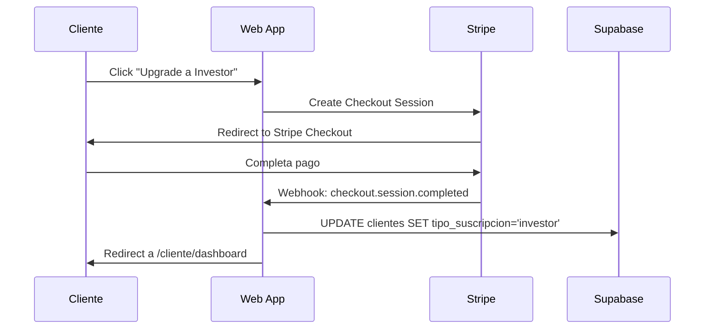

> Documento histórico del prototipo. Para el estado operativo, las limitaciones y el despliegue actual, consulta README.md y docs/ del repositorio.

# Arquitectura Portal Cliente - InmoFinder

## 1. Visión General

Sistema dual de portales con separación clara entre empleados y clientes, integrado con pasarela de pago Stripe para gestión de suscripciones.

### 1.1 Portales

#### Portal Empleados (Actual)
- **Rutas**: `/dashboard`, `/propiedades`, `/clientes`, `/matchings`, `/scraper`, `/metricas`, `/settings`
- **Acceso**: Solo usuarios con rol `admin` en tabla `user_roles`
- **Funcionalidad**: Gestión completa del sistema, análisis avanzado, scraping, métricas detalladas

#### Portal Cliente (Nuevo)
- **Rutas**: `/cliente/dashboard`, `/cliente/suscripcion`, `/cliente/perfil`, `/cliente/mercado`
- **Acceso**: Usuarios autenticados sin rol admin (clientes registrados en tabla `clientes`)
- **Funcionalidad**: Vista limitada de matchings, gestión de suscripción, análisis de mercado resumido

---

## 2. Sistema de Roles y Permisos

### 2.1 Estructura de Roles

```sql
-- Ya existe el enum app_role
type app_role = 'admin' | 'moderator' | 'user'

-- Ya existe la tabla user_roles
table user_roles {
  id: uuid
  user_id: uuid (FK -> auth.users)
  role: app_role
}

-- Ya existe la función has_role
function has_role(user_id, role) -> boolean
```

### 2.2 Lógica de Autorización

#### Middleware de Rutas
```typescript
// Protección de rutas de empleados
if (route.startsWith('/dashboard') || route.startsWith('/propiedades') || ...) {
  if (!has_role(user_id, 'admin')) {
    redirect('/cliente/dashboard') // o 403
  }
}

// Protección de rutas de clientes
if (route.startsWith('/cliente')) {
  if (has_role(user_id, 'admin')) {
    redirect('/dashboard')
  }
  if (!authenticated) {
    redirect('/auth')
  }
}
```

### 2.3 Matriz de Permisos

| Funcionalidad | Admin | Free | Básico | Inversor | Inversor Premium |
|---------------|-------|------|--------|----------|------------------|
| Ver todas las propiedades | ✅ | ❌ | ❌ | ❌ | ❌ |
| Ver propios matchings | ✅ | ✅ (5/mes) | ✅ (20/mes) | ✅ ilimitado | ✅ ilimitado |
| Editar criterios búsqueda | ✅ | ❌ | ✅ básico | ✅ avanzado | ✅ avanzado |
| Análisis mercado completo | ✅ | ❌ | ❌ | ❌ | ❌ |
| Análisis mercado resumido | ✅ | ✅ básico | ✅ mejorado | ✅ completo | ✅ completo |
| Recibir informes WhatsApp | ✅ | ❌ | ❌ | ✅ (20/mes) | ✅ ilimitado |
| Descargar PDF análisis | ✅ | ❌ | ❌ | ✅ | ✅ |
| Descargar PDF presupuesto | ✅ | ❌ | ❌ | ✅ | ✅ |
| Gestionar suscripción | ❌ | ✅ | ✅ | ✅ | ✅ |
| Acceso API | ❌ | ❌ | ❌ | ❌ | ✅ |
| Scraping manual | ✅ | ❌ | ❌ | ❌ | ❌ |
| Ver métricas detalladas | ✅ | ❌ | ❌ | ❌ | ❌ |

---

## 3. Integración con Stripe

### 3.1 Planes de Suscripción

#### Plan Free (€0/mes)
- ✅ Ver hasta 5 matchings por mes
- ✅ Dashboard básico de mercado
- ❌ Sin informes personalizados
- ❌ Sin WhatsApp
- ❌ Sin edición de criterios

#### Plan Básico (€9.99/mes)
- ✅ Ver hasta 20 matchings por mes
- ✅ Dashboard de mercado mejorado
- ✅ Editar criterios de búsqueda
- ❌ Sin PDFs personalizados
- ❌ Sin WhatsApp

#### Plan Inversor (€49.99/mes)
- ✅ Ver matchings ilimitados
- ✅ Dashboard de mercado completo (versión cliente)
- ✅ Descargar PDF análisis y presupuesto ilimitados
- ✅ Editar criterios de búsqueda avanzada
- ✅ Recibir hasta 20 informes WhatsApp/mes
- ❌ Sin informes WhatsApp ilimitados

#### Plan Inversor Premium (€149.99/mes)
- ✅ Todo lo de Inversor
- ✅ Informes WhatsApp ilimitados
- ✅ Alertas en tiempo real de nuevos matchings
- ✅ Prioridad en análisis de propiedades
- ✅ Asesoramiento personalizado (contacto directo)
- ✅ Acceso API para integraciones

### 3.2 Flujo de Stripe



### 3.3 Productos Stripe a Crear

```typescript
// Edge function: create-stripe-products
const products = [
  {
    name: "InmoFinder Básico",
    price: 999, // €9.99 en centavos
    interval: "month",
    features: [
      "Hasta 20 matchings/mes",
      "Dashboard mejorado",
      "Editar criterios"
    ]
  },
  {
    name: "InmoFinder Inversor",
    price: 4999, // €49.99
    interval: "month",
    features: [
      "Matchings ilimitados",
      "PDFs personalizados ilimitados",
      "20 informes WhatsApp/mes",
      "Dashboard completo"
    ]
  },
  {
    name: "InmoFinder Inversor Premium",
    price: 14999, // €149.99
    interval: "month",
    features: [
      "Todo de Inversor",
      "WhatsApp ilimitado",
      "Alertas en tiempo real",
      "Asesoramiento personalizado",
      "Acceso API"
    ]
  }
]
```

### 3.4 Webhooks de Stripe

Edge function: `stripe-webhook-handler`

Eventos a manejar:
- `checkout.session.completed` → Activar suscripción
- `customer.subscription.updated` → Actualizar tier
- `customer.subscription.deleted` → Downgrade a Free
- `invoice.payment_failed` → Notificar cliente

---

## 4. Dashboard Análisis de Mercado

### 4.1 Versión Empleados (Actual `/metricas`)
**Información completa y detallada:**
- Métricas por barrio con histórico completo
- Tendencias de precios con gráficos detallados
- Proyecciones de revalorización
- Índice de dinamismo del mercado
- Análisis comparativo entre barrios
- Datos de todas las propiedades scrapeadas
- Filtros avanzados y exportación

### 4.2 Versión Clientes (`/cliente/mercado`)
**Información resumida y estratégica:**

#### Vista General
- **Top 3 barrios más prometedores** (según proyección revalorización)
  - Nombre del barrio
  - Precio m² medio (sin percentiles)
  - Tendencia (↑ subiendo / → estable / ↓ bajando)
  - % de revalorización proyectada (anual)

#### Comparador Básico
- Seleccionar hasta 2 barrios para comparar
- Mostrar solo:
  - Precio medio
  - Precio m²
  - Tendencia general
  - Número de propiedades disponibles (aproximado)

#### Alertas de Oportunidad
- Notificaciones de barrios que cumplan criterios del cliente:
  - "Precio m² bajó 5% en {barrio} este mes"
  - "Nueva propiedad en {barrio} por debajo del precio medio"

#### Restricciones
- ❌ Sin acceso a histórico detallado
- ❌ Sin percentiles ni distribuciones
- ❌ Sin índice de dinamismo
- ❌ Sin datos de todas las propiedades (solo agregados)
- ❌ Sin exportación de datos

### 4.3 Queries de Datos

```typescript
// Portal Empleados: datos completos
const metricasEmpleados = await supabase
  .from('metricas_barrios')
  .select('*')
  .order('proyeccion_revalorizacion_anual', { ascending: false });

const historicoCompleto = await supabase
  .from('metricas_barrios_historico')
  .select('*')
  .gte('fecha_snapshot', hace6Meses);

// Portal Clientes: solo top 3 y datos resumidos
const metricasClientes = await supabase
  .from('metricas_barrios')
  .select('ciudad, barrio, precio_m2_medio, tendencia, proyeccion_revalorizacion_anual, total_propiedades')
  .order('proyeccion_revalorizacion_anual', { ascending: false })
  .limit(3);
```

---

## 5. Estructura de Rutas

### 5.1 Rutas Públicas
- `/` - Landing page
- `/auth` - Login/Signup

### 5.2 Rutas Empleados (require rol admin)
- `/dashboard` - Panel principal empleados
- `/propiedades` - Gestión de propiedades
- `/clientes` - Gestión de clientes
- `/matchings` - Matchings globales
- `/scraper` - Control de scraping
- `/metricas` - Análisis completo de mercado
- `/settings` - Configuración empleado

### 5.3 Rutas Clientes (require autenticación sin rol admin)
- `/cliente/dashboard` - Panel principal cliente
- `/cliente/matchings` - Ver propios matchings
- `/cliente/suscripcion` - Gestionar suscripción Stripe
- `/cliente/perfil` - Editar perfil y criterios (solo Investor+)
- `/cliente/mercado` - Dashboard de mercado resumido
- `/cliente/settings` - Configuración básica

### 5.4 Componente de Protección de Rutas

```typescript
// components/ProtectedRoute.tsx
interface ProtectedRouteProps {
  children: React.ReactNode;
  requiredRole?: 'admin' | 'cliente';
}

const ProtectedRoute = ({ children, requiredRole }: ProtectedRouteProps) => {
  const [user, setUser] = useState(null);
  const [isAdmin, setIsAdmin] = useState(false);
  const [loading, setLoading] = useState(true);
  
  useEffect(() => {
    // Check auth
    // Check role
    // Redirect if unauthorized
  }, []);
  
  if (loading) return <Loading />;
  
  return <>{children}</>;
};
```

---

## 6. Modificaciones a la Base de Datos

### 6.1 Tabla clientes (modificar)

```sql
-- Añadir campos para límites de suscripción
ALTER TABLE clientes
ADD COLUMN matchings_vistos_mes INTEGER DEFAULT 0,
ADD COLUMN whatsapp_enviados_mes INTEGER DEFAULT 0,
ADD COLUMN ultimo_reset_limites TIMESTAMP WITH TIME ZONE DEFAULT now();

-- Trigger para resetear límites cada mes
CREATE OR REPLACE FUNCTION reset_monthly_limits()
RETURNS void
LANGUAGE plpgsql
SECURITY DEFINER
AS $$
BEGIN
  UPDATE clientes
  SET matchings_vistos_mes = 0,
      whatsapp_enviados_mes = 0,
      ultimo_reset_limites = now()
  WHERE ultimo_reset_limites < now() - INTERVAL '1 month';
END;
$$;
```

### 6.2 Tabla stripe_customers (nueva)

```sql
CREATE TABLE stripe_customers (
  id UUID PRIMARY KEY DEFAULT gen_random_uuid(),
  cliente_id UUID REFERENCES clientes(id) ON DELETE CASCADE NOT NULL,
  stripe_customer_id TEXT NOT NULL UNIQUE,
  stripe_subscription_id TEXT,
  subscription_status TEXT,
  current_period_end TIMESTAMP WITH TIME ZONE,
  created_at TIMESTAMP WITH TIME ZONE DEFAULT now(),
  updated_at TIMESTAMP WITH TIME ZONE DEFAULT now()
);

ALTER TABLE stripe_customers ENABLE ROW LEVEL SECURITY;

CREATE POLICY "Users can view their own stripe data"
ON stripe_customers FOR SELECT
USING (EXISTS (
  SELECT 1 FROM clientes
  WHERE clientes.id = stripe_customers.cliente_id
  AND clientes.user_id = auth.uid()
));
```

### 6.3 Políticas RLS para Portal Cliente

```sql
-- Los clientes solo ven sus propios matchings
CREATE POLICY "Clientes ven solo sus matchings"
ON matchings FOR SELECT
USING (
  cliente_id IN (
    SELECT id FROM clientes WHERE user_id = auth.uid()
  )
  AND NOT has_role(auth.uid(), 'admin')
);

-- Limitar matchings para plan free
CREATE OR REPLACE FUNCTION check_matching_limit()
RETURNS TRIGGER
LANGUAGE plpgsql
SECURITY DEFINER
AS $$
DECLARE
  cliente_record RECORD;
BEGIN
  SELECT tipo_suscripcion, matchings_vistos_mes
  INTO cliente_record
  FROM clientes
  WHERE id = NEW.cliente_id;
  
  IF cliente_record.tipo_suscripcion = 'free' 
     AND cliente_record.matchings_vistos_mes >= 5 THEN
    RAISE EXCEPTION 'Límite de matchings alcanzado. Actualiza a plan Investor.';
  END IF;
  
  RETURN NEW;
END;
$$;
```

---

## 7. Implementación por Fases

### Fase 1: Infraestructura Base (Semana 1)
- [ ] Crear tabla `stripe_customers`
- [ ] Modificar tabla `clientes` con campos de límites
- [ ] Implementar protección de rutas (ProtectedRoute)
- [ ] Crear layout base para portal cliente
- [ ] Configurar integración Stripe

### Fase 2: Portal Cliente Core (Semana 2)
- [ ] Página `/cliente/dashboard`
- [ ] Página `/cliente/matchings` con límites
- [ ] Página `/cliente/perfil`
- [ ] Sistema de navegación cliente

### Fase 3: Suscripciones (Semana 3)
- [ ] Página `/cliente/suscripcion`
- [ ] Edge function: `create-checkout-session`
- [ ] Edge function: `stripe-webhook-handler`
- [ ] Portal de facturación (Stripe Customer Portal)
- [ ] Lógica de límites por tier

### Fase 4: Dashboard Mercado (Semana 4)
- [ ] Página `/cliente/mercado`
- [ ] Query de top 3 barrios prometedores
- [ ] Comparador de 2 barrios
- [ ] Sistema de alertas de oportunidad
- [ ] Gráficos simplificados

### Fase 5: Pulido y Testing (Semana 5)
- [ ] Testing de flujos de pago
- [ ] Testing de límites de suscripción
- [ ] Emails transaccionales
- [ ] Onboarding para nuevos clientes
- [ ] Documentación de usuario

---

## 8. Consideraciones de Seguridad

### 8.1 Prevención de Escalada de Privilegios
- ✅ Roles en tabla separada (`user_roles`), no en `clientes` ni `auth.users`
- ✅ Función `has_role` con `SECURITY DEFINER`
- ✅ RLS policies que usan `has_role(auth.uid(), 'admin')`
- ✅ Nunca validar roles en localStorage/sessionStorage

### 8.2 Validación de Límites Server-Side
- ✅ Triggers en base de datos para límites de suscripción
- ✅ Edge functions validan tier antes de enviar WhatsApp
- ✅ No confiar en validaciones frontend

### 8.3 Datos Sensibles
- ❌ Clientes NO ven datos de otros clientes
- ❌ Clientes NO ven métricas detalladas reservadas a empleados
- ✅ Stripe webhook verifica signature
- ✅ Secrets en Supabase (no en código)

---

## 9. Flujos de Usuario Clave

### 9.1 Cliente Nuevo
1. Accede a landing → Click "Comenzar"
2. Signup en `/auth` → crea cuenta
3. Redirect a `/cliente/dashboard`
4. Ve banner "Estás en plan Free (5 matchings/mes)"
5. Si ve más de 5 matchings → mensaje upgrade
6. Click "Upgrade" → `/cliente/suscripcion`
7. Selecciona plan → Stripe Checkout
8. Pago exitoso → tipo_suscripcion='investor'
9. Acceso a funciones premium

### 9.2 Cliente Existente - Ver Matching
1. Login → `/cliente/dashboard`
2. Ve lista de últimos matchings (limitados por tier)
3. Click en matching → detalle de propiedad
4. Si tier >= investor:
   - Botón "Descargar Análisis PDF"
   - Botón "Descargar Presupuesto PDF"
5. Si tier = platino:
   - Botón "Recibir por WhatsApp"
6. Si tier = free:
   - Ver solo info básica
   - Banner "Upgrade para descargar análisis"

### 9.3 Cliente Gestiona Suscripción
1. `/cliente/suscripcion`
2. Ve plan actual y features
3. Opciones:
   - Upgrade (si free o investor)
   - Downgrade (si investor o platino)
   - Cancelar (downgrade a free al final del periodo)
   - Ver facturas (Stripe Customer Portal)
4. Cambios efectivos:
   - Upgrade: inmediato tras pago
   - Downgrade: al final del periodo de facturación

---

## 10. Métricas y Analytics

### 10.1 KPIs a Trackear
- Conversión free → investor
- Conversión investor → platino
- Churn rate por tier
- Uso de matchings por tier
- Uso de informes WhatsApp (platino)
- Engagement dashboard mercado

### 10.2 Tabla Analytics (opcional)

```sql
CREATE TABLE client_usage_stats (
  id UUID PRIMARY KEY DEFAULT gen_random_uuid(),
  cliente_id UUID REFERENCES clientes(id),
  fecha DATE DEFAULT CURRENT_DATE,
  matchings_vistos INT DEFAULT 0,
  pdfs_descargados INT DEFAULT 0,
  whatsapp_enviados INT DEFAULT 0,
  tiempo_sesion_minutos INT DEFAULT 0
);
```

---

## 11. Preguntas Pendientes para el Cliente

1. **Precios de suscripciones** (✅ Definidos):
   - Free: €0
   - Básico: €9.99/mes
   - Inversor: €49.99/mes
   - Inversor Premium: €149.99/mes
   - ¿Incluir plan anual con descuento (ej: 10% off)?

2. **Límites del plan Free**:
   - ¿5 matchings/mes es suficiente o muy restrictivo?
   - ¿Permitir editar criterios en free?

3. **Funcionalidades dashboard mercado cliente**:
   - ¿Solo top 3 barrios o top 5?
   - ¿Incluir mapa visual o solo lista?

4. **Onboarding**:
   - ¿Tour guiado para nuevos clientes?
   - ¿Email de bienvenida con instrucciones?

5. **Comunicación con empleados**:
   - ¿Clientes platino pueden abrir tickets de soporte?
   - ¿Chat directo con empleados?

---

## 12. Próximos Pasos

1. **Revisar y aprobar** esta arquitectura
2. **Definir precios** y features finales de cada tier
3. **Habilitar Stripe** en el proyecto Supabase
4. **Comenzar Fase 1**: Infraestructura base
5. **Iterar** según feedback

---

**Documento vivo - Última actualización: 2025-10-29**

